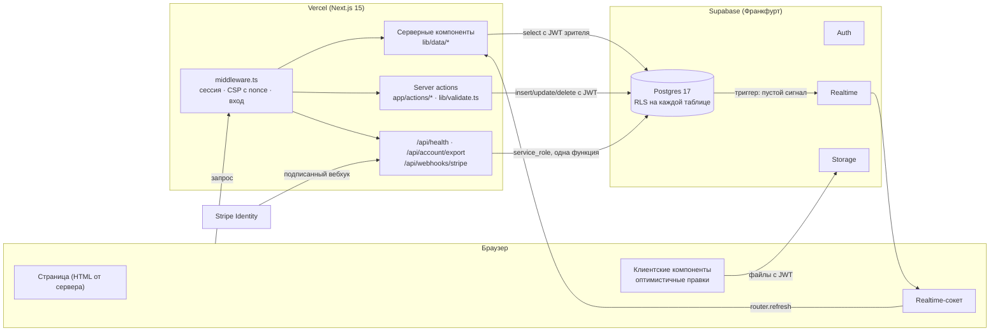

# Архитектура

Как устроен To Get There: из чего состоит, куда идут данные, где проходят
границы прав и почему решения именно такие.

## Одной картинкой

## Главный принцип: права решает база

Ни одна проверка прав не живёт только в приложении. Каждый запрос — чтение
и запись, сервер и браузер — идёт в Postgres с JWT зрителя, и политики RLS
решают, что можно. API Supabase открыт напрямую (`/rest/v1`), поэтому
проверка в server action без политики в базе была бы декорацией.

Приложение делает три вещи поверх этого:

1. **Проверяет форму данных** (`lib/validate.ts`) — server action публичен,
   типы TypeScript стираются при сборке.
2. **Показывает только допустимое** — меню «⋯» предлагает ровно те действия,
   которые база разрешит (`rightsOf`, `actionsOf`), чтобы ничего не
   предлагалось и потом не отклонялось.
3. **Объясняет отказ словами** — коды Postgres переводятся в русский
   (`lib/actions/actor.ts`).

Исключение одно: вебхук Stripe приходит без сессии и пишет итог проверки
личности функцией `apply_verification_result()`, которую может вызвать
только `service_role`.

## Слои

| Слой | Где | Что делает |
|---|---|---|
| Маршруты | `app/(app)/*`, `app/auth/*`, `app/legal/*` | Серверные страницы. Читают данные один раз и передают пропсами. |
| Данные (чтение) | `lib/data/*` | Запросы к Supabase с RLS. `lib/data/index.ts` переключает на моки. |
| Действия (запись) | `app/actions/*` | Server actions: проверка ввода → запрос с JWT → понятная ошибка. |
| Чистые правила | `lib/access.ts`, `lib/format.ts`, `lib/search-filter.ts`, `lib/place.ts` | Без сети и без React; покрыты юнит-тестами. |
| Живые экраны | `lib/live.ts`, `lib/use-presence.ts`, `lib/use-synced-state.ts` | Сигналы Realtime, «печатает», слияние снимков с правками «в полёте». |
| Примитивы UI | `components/ui/*` | Кнопки, поля, листы на `<dialog>`, иконки — без UI-кита. |
| Экраны | `components/<раздел>/*` | Клиентские компоненты экранов. |
| База | `supabase/migrations/*` | Схема, RLS, триггеры, cron. Только вперёд, старые не правятся. |

## Живые обновления

Данные в сокет не идут. Триггеры в базе шлют **пустой** сигнал
«изменилось» в приватный канал (`post:<id>`, `user:<id>`, 0018), клиент
просит сервер перерисовать страницу (`router.refresh`), и свежие данные
приходят обычным путём — через RLS. Второй копии правил доступа на клиенте
нет, а пачка сигналов схлопывается в одно обновление.

«Печатает…» и «сейчас в чате» — отдельные каналы `chat:<id>` и
`dm:<a>:<b>` (0033), в которые клиенты пишут сами. Разделение значит, что
подделать сигнал «изменилось» клиент не может. Имена для «печатает» берутся
из состава чата, а не из сообщения в канале.

## Оптимистичные правки

Отправка, голос, закрепление, вступление меняют экран сразу. Если сервер
отказал — экран возвращается к состоянию до нажатия и говорит почему
(`notify`). Когда приходит свежий снимок с сервера, `useSyncedState`
сливает его с локальными правками, которые сервер ещё не подтвердил.

## Безопасность на границе

- **CSP с nonce на каждый запрос** (`lib/csp.ts`, `middleware.ts`): скрипты
  только свои. Поэтому корневой макет рендерится на запрос — у заранее
  собранной страницы скрипты были бы без nonce.
- **Заголовки** (`next.config.ts`): HSTS, `frame-ancestors 'none'`,
  `nosniff`, Referrer-Policy, Permissions-Policy, COOP.
- **Ограничение частоты** — в базе (0031), а не в приложении.
- Подробно — `docs/SECURITY.md`.

## Демо-режим

`NEXT_PUBLIC_USE_MOCKS=true` — все экраны рисуются из `lib/mock`, без базы
и без входа. На нём идут E2E (детерминированно, без секретов в CI), и на
нём можно показать продукт офлайн. Запись в демо честно отвечает, что не
сохраняется. Мок-слой повторяет сигнатуры `lib/data`, поэтому экраны не
знают, откуда пришли данные.

## Тесты

| Уровень | Где | Что проверяет | Где запускается |
|---|---|---|---|
| Юнит | `lib/*.test.ts` | правила, форматирование, проверка ввода, CSP | `npm test`, CI |
| База | `supabase/tests/database/*` | RLS и триггеры от имени настоящих пользователей; миграции с нуля | `supabase test db`, CI |
| E2E | `e2e/*` | каждый экран, axe (WCAG 2.2 AA), клавиатура, телефон | `npm run test:e2e`, CI |
| E2E со входом | `e2e-live/*` | регистрация с письмом (Mailpit), вход, выход, истёкшая сессия, сброс пароля, запись, realtime у двоих, приватность интересов | `npm run test:e2e:live`, CI |
| Нагрузка | `supabase/perf/*` | планы и время запросов ленты, чата, поиска на десятках тысяч строк под RLS | `psql … -f supabase/perf/load.sql`, CI |
| Статический анализ | CodeQL, `supabase db lint`, советник Supabase | уязвимости в коде и схеме | CI, панель |

## Решения, которые стоит знать

- **Нет UI-кита и библиотек иконок и дат.** Меньше зависимостей — меньше
  уязвимостей и килобайт; дизайн-система своя (`docs/DESIGN.md`).
- **Лента — расписание, а не алгоритм.** Сортировка по времени начала;
  идея уходит из ленты через час после начала.
- **История чатов — последние 300 сообщений.** Чат идеи живёт вокруг одной
  встречи; без предела страница тянула бы всю историю на каждый сигнал.
- **Поиск людей — на сервере** (0036): в браузер уходят совпадения, а не
  все профили.
- **Удаление — настоящее**, не мягкое: удалённое сообщение, идея или
  аккаунт исчезают из базы (каскады) и из Storage. Для модерации остаётся
  только снимок в жалобе, и тот — на ограниченный срок.
